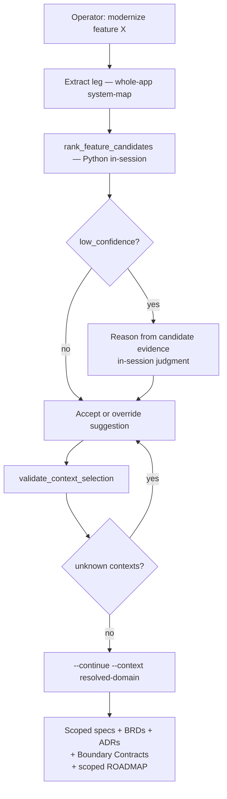

# /mod-modernization-scope

Correlate the required analysis artifacts into the four modernization deliverables. This is a
**Python-load-bearing** primitive: `"${CLAUDE_PLUGIN_ROOT}/bin/forge-validate" mod-modernization-scope` runs the deterministic
pipeline (artifact discovery, the SP1 adapters, `build_system_map`, deconstruction rendering, spec
+ ADR + roadmap rendering, and citation refcheck) and this body authors the synthesis JSON (spec
requirements, ADR decisions, and `path:line` citations). The body never writes source files
directly — its only filesystem effect is authoring `synthesis.json` to the state dir.

## How to invoke

```
/mod-modernization-scope
```

## When to invoke

- When the user asks to "scope a modernization", "produce a modernization plan / roadmap",
  "deconstruct the system", or "write modernization specs" for a repository.
- After the four analyzers have run and left their artifacts under `.foundry/context/`:
  `/functional-map` (S61), `/mod-db-schema-analyze` (M1), `/api-contract-review` (S40), and
  `/mod-app-analysis` (SP3). This primitive **requires** all four — it never synthesizes from
  thin air. A missing artifact hard-errors naming the analyzer to run (exit 2).

## When invoked

1. **Extract — correlate artifacts, build skeletons, emit synthesis prompts (exit 7).** Run:
   ```bash
   "${CLAUDE_PLUGIN_ROOT}/bin/forge-validate" mod-modernization-scope --code-root <ROOT> --run-id <RUN-ID> --extract-only
   ```
   Use the same `<RUN-ID>` throughout the extract → synthesize → continue cycle. When invoked
   by the `/mod-modernization` orchestrator, the orchestrator mints a `run-<8hex>` id and must
   pass it here so the state dir `<state-dir>/<run-id>/` is unambiguous and co-located with the
   orchestrator's own state file (see the `--run-id` invariant below). When invoked standalone
   the default `--run-id run` is acceptable.

   The CLI auto-discovers the four artifacts under `.foundry/context/`, runs the SP1 adapters
   (`functional_map`, `api`, `app_digest`, plus the DB schema), calls `build_system_map` to thread
   the cross-layer UI→API→DB dependency graph, writes the deconstruction (`MODERNIZATION.md` +
   `system-map.json`) durably to `.foundry/context/modernization/`, builds one spec skeleton per
   bounded context and one ADR skeleton per structural concern, writes
   `synthesis_prompts.json` under `<state-dir>/<run-id>/`, and exits 7 ("awaiting judgments").

   **Optional legacy-test grounding (SP-G, #1387).** When a `test-inventory.json` (from
   `/mod-test-inventory`) is present under `.foundry/context/modernization/<repo>/` — or passed
   via `--test-inventory PATH` — the CLI slices those legacy tests by bounded context (the same
   `context_resolver` join) and threads each context's tests into its spec prompt as
   `parity_oracles`. This is **additive**: absent the inventory, no `parity_oracles` are threaded
   and §11 renders synthesized T- scenarios exactly as before (no regression).
   Hard stops: a required artifact missing (exit 2, naming the analyzer to run), `--code-root`
   not a directory (exit 2).

2. **Synthesize — author `synthesis.json`.** Read `synthesis_prompts.json` from the state dir. It
   carries `context.nodes` (the system-map nodes with `id`/`kind`/`domain`) plus a `specs[]` list
   (one item per bounded context, each with `id`, `domain`, `title`, `components`, an authoring
   `instruction`, and — when the functional-map slice is available — a `slice` of pre-extracted
   facts) and an `adrs[]` list (one item per cross-cutting concern, each with `id`, `title`).
   **Match each item by its `id`.**

   **Author from the slice, and follow the item's `instruction` (SP-D, #1384).** Each spec item's
   `slice` carries the pre-extracted `business_rules`, `validation_rules`, `acceptance_criteria`,
   `form_fields`, `nav_edges`, `flows`, `guards`, `business_contexts`, and `i18n` for that context.
   The `instruction` embeds the enumeration discipline you must apply:

   - **Enumerate, don't summarize** — list EVERY business rule / field constraint / acceptance
     criterion in the slice as its own `R-` / `AC-`; completeness matters more than brevity (one
     `R-` per distinct rule — do not collapse several rules into one requirement).
   - **Carry-forward, don't invent** — the slice's collections are pre-extracted facts; carry them
     into the spec's `requirements` / `acceptance_criteria` / `test_scenarios` verbatim. Do NOT
     invent rules the analysis did not surface; mark any step you must infer `⚠️ INFERRED`.
   - **Traceability mandate** — every `R-` gets ≥1 `AC-` and ≥1 `T-`; every `AC-` cites its `R-`
     (in `covers`) and its `T-` (in `verified_by`). The render-time matrix enforces this.
   - **Interpretive scope** — read cited source ONLY to author rationale, derive parity ACs, and
     judge migration risk; NOT to re-enumerate what the slice already extracted.

   Author a `synthesis.json` conforming to the **v2.0 / v2.1 / v2.2 synthesis schema** — a
   **worked, validating** example is at `references/schemas/synthesis.json`; the field contract:

   - `schema_version`: **`"2.0"`**, **`"2.1"`**, or **`"2.2"`** (the old `"1.0"` flat shape is
     rejected — see migration note below). Use `"2.1"` when you author `kind: "target"` §8b
     endpoints (SP3, #1411); `"2.2"` when you author the Track-C BRD narrative fields
     (`business_narrative` / `kpis` / `business_glossary` / `assumptions` / `business_risks`);
     `"2.0"` / `"2.1"` still validate (each bump is additive — the new fields default empty).
   - `specs[]` — one `SpecJudgment` per prompt spec item you address:
     - `spec_id` — copy the prompt item's `id` verbatim (e.g. `"spec-customer"`).
     - `title`, `description`, `context` — role-complete prose scoped to this context.
     - `requirements` — a **list of `Requirement` objects** (NOT plain strings). Each object:
       - `id` — stable `R-NNN` identifier you assign (e.g. `"R-001"`, `"R-002"`).
       - `statement` — the requirement in one sentence.
       - `scope` — the component/entity/endpoint this requirement governs.
       - `constraint` — measurable constraint or acceptance bound.
       - `source` — a `file:line` evidence reference under `--code-root`.
       - `rationale` — why this requirement exists.
       - `priority` — `"must"` / `"should"` / `"nice-to-have"`.
     - `acceptance_criteria` — a **list of `AcceptanceCriterion` objects** (top-level, not nested
       under a single requirement — one requirement may have multiple ACs):
       - `id` — `AC-NNN`.
       - `given`, `when`, `then` — BDD scenario text.
       - `covers` — list of `R-` ids this criterion validates (e.g. `["R-001"]`).
       - `verified_by` — list of `T-` ids that exercise it (e.g. `["T-001"]`).
       - `is_parity` — `true` if this criterion preserves existing / legacy behaviour.
     - `test_scenarios` — a **list of `TestScenarioSpec` objects**:
       - `id` — `T-NNN`.
       - `type` — `"unit"` / `"integration"` / `"e2e"`.
       - `scenario` — one-sentence description.
       - `preconditions`, `input`, `expected` — structured test framing.
       - `covers` — list of `R-` ids.
       - `is_parity_oracle` — `true` if grounded in existing legacy tests. When the spec item
         carries a `parity_oracles` list (SP-G, #1387: this context's legacy tests from
         `/mod-test-inventory`), carry EACH one into `test_scenarios` as its own `T-` with
         `is_parity_oracle: true`, preserving its `assertion_intent` and `source` — these ground
         §11 acceptance against actual legacy behaviour. Leave synthesized (gap-filling) scenarios
         `is_parity_oracle: false`.
     - `architecture_decisions` — a **list of `ArchitectureDecision` objects** (inline ADRs
       scoped to this spec, distinct from the standalone cross-cutting `adrs[]` below):
       - `id` — `ADR-NNN`.
       - `title`, `context`, `decision` — ADR prose.
       - `consequences`, `alternatives` — lists of strings.
       - `affects` — list of `R-` ids this decision is relevant to.
     - `data_field_mappings` — list of `DataFieldMapping` objects (`legacy`/`target`/`type`/
       `migration_notes`). **Default-empty now** — populated by SP-E (M1 integration).
     - `api_endpoints` — list of `ApiEndpoint` objects (`verb`/`path`/`request`/`response`/
       `status_codes`/`validation`/`security`/`kind`/`from_controller`). Two roles (SP3, #1411):
       - **§8 Current API Surface** — endpoints with `kind: "current"` (or unset). Populated by
         SP-F (S40 integration); §8 ALSO merges the functional-map controller inventory from the
         prompt's `slice`, so §8 renders even with no S40 contract. Set `from_controller` to the
         current handler if known (else leave empty).
       - **§8b Target REST API** — rendered ONLY when the prompt item carries the §8b directive
         (a modernization target is set). Synthesize a **resource-per-aggregate** target REST API
         from this context's `functional_requirements` + DB aggregates in the target backend's
         idiom, emitting each as its own entry with `kind: "target"`, a REST verb + resource path
         (e.g. `POST /api/owners`), request/response DTO names, status codes, the `validation`
         R- ids it enforces, `security` roles, and `from_controller` tracing the current controller
         form-flow it replaces (e.g. `"OwnerController.processCreationForm"`). Leave
         `from_controller` empty ONLY for a genuinely new target endpoint. Do NOT fabricate
         resources with no backing FR or aggregate. Absent the §8b directive, author current-only
         endpoints and keep `schema_version: "2.0"`.
     - `user_flows` — list of `UserFlowSpec` objects (`id`/`name`/`steps`/`variant`/
       `sequence_diagram`). Populated from the SP-A per-context functional-map slice.
       - `sequence_diagram` (SP5, #1413) — rendered into §6 flows ONLY when the prompt item
         carries the **TARGET SEQUENCE FLOW** directive (a target is set). For each KEY flow,
         author a Mermaid `sequenceDiagram` of the TARGET request path (component → REST
         controller → service → repository/DB), designing the path rather than echoing the
         legacy nav-edges. Leave empty for a flow with no request path (no fabrication).
     - `ui_mockup` (SP5, #1413) — a Mermaid string of THIS spec's target UI screen, rendered
       into §7 UX/UI ONLY when the prompt item carries the **TARGET UI MOCKUP** directive (a
       target is set). Author a `flowchart` of the target component + its reactive-form field
       layout in the target frontend's idiom (grouping the functional-map `form_fields`); do
       NOT merely echo the legacy page. Leave empty if this context has no UI surface (no
       fabrication). Use `"2.1"` when you author `ui_mockup` / `sequence_diagram`.
     - `nfrs` — list of `Nfr` objects (`id`/`category`/`requirement`/`source`).
     - `citations` — `path:line` evidence refs (relative to `--code-root`) grounding the spec;
       the engine appends them to the rendered spec and Phase D refchecks every one.
     - `dod_extra` — extra Definition-of-Done bullets (optional).
     - **BRD narrative fields (Track C, #1429)** — the business-audience prose for THIS context's
       `BRD.md` (emitted beside the spec, sharing the SAME `R-`/`FR-` ids). Author each for a
       **non-technical** reader; leave any empty when there is nothing real to say (no fabrication
       — an empty field renders a sparser, honest BRD section). Use `"2.2"` when you author these.
       - `business_narrative` — a plain-language executive framing of what this capability does
         and why it matters (not technical).
       - `kpis` — measurable business success metrics as plain-language bullets.
       - `business_glossary` — business terms as `Term: definition` bullets.
       - `assumptions` — business assumptions the capability relies on.
       - `business_risks` — the business impact if this capability is mis-migrated.
       - `business_process_diagram` / `capability_map` (optional) — override the deterministic
         business diagrams with your own Mermaid ONLY when you have materially richer framing; the
         four business diagrams otherwise render from the extracted structure automatically.
   - `adrs[]` — one `AdrJudgment` per prompt ADR item you address:
     - `adr_id` — copy the prompt item's `id` verbatim.
     - `title`, `status` (`Proposed`|`Accepted`|`Deprecated`|`Superseded`), `context`, `decision`.
     - `consequences`, `alternatives` — bullet lists.
     - `affected_requirements` — the `R-` ids the decision addresses (e.g. `["R-001","R-002"]`).
     - `citations` — `path:line` evidence refs.

   **Migration note — old `"1.0"` flat shape is rejected (SP-B, #1382).** The old
   `requirements: ["one string", "two string"]` flat list and `decisions: ["..."]` flat list
   are no longer valid. The continue leg will exit 3 with a clear message if it detects them.
   Update any cached `synthesis.json` to `schema_version: "2.0"` and replace each plain string
   with the structured object described above.

   **Key invariants:**
   - **Every citation MUST resolve** to a real `path:line` under `--code-root`. Phase D refchecks
     the concatenated spec/ADR markdown; any broken citation → exit 6. Cite lines you have read.
   - **The synthesis schema forbids unknown keys** (`extra="forbid"`). Any stray field → exit 3.
   - **Author `R-`/`AC-`/`T-`/`ADR-` ids yourself** — assign them sequentially within each spec
     (e.g. `R-001`, `R-002`; `AC-001`, `AC-002`; `T-001`, `T-002`; `ADR-001`). The engine uses
     the ids you assign in the traceability matrix; the `covers`/`verified_by`/`affects` cross-
     references must be consistent (e.g. an AC `covers: ["R-001"]` references an `R-001` you
     also authored).
   - **`schema_version` must be `"2.0"`, `"2.1"`, or `"2.2"`** — the old `"1.0"` flat shape is
     rejected at exit 3. Use `"2.1"` when authoring `kind: "target"` §8b endpoints (SP3, #1411);
     `"2.2"` when authoring the Track-C BRD narrative fields (#1429).

   Write `synthesis.json` to `<state-dir>/<run-id>/synthesis.json` (default state dir
   `.foundry/context/modernization/.state`; default run-id `run`). Use the **same run-id**
   as the extract step — both state files (`system-map.json` and `synthesis.json`) must share
   one directory.

3. **Continue — render and refcheck.** Re-invoke:
   ```bash
   "${CLAUDE_PLUGIN_ROOT}/bin/forge-validate" mod-modernization-scope --code-root <ROOT> \
     --run-id <RUN-ID> --continue --judgments <state-dir>/<run-id>/synthesis.json
   ```
   The CLI reloads the system-map, merges the authored judgments, renders the role-complete specs
   (`scope/<item>.spec.md`), the per-context business BRDs (`scope/<item>.brd.md` + the top-level
   `BRD.md` overview), the standalone ADRs (`adr/ADR-NNNN-*.md`), and the wave-by-wave `ROADMAP.md`
   (via `sequencer.order`), and refchecks every citation. Exits 0 on success, 6 if any citation
   does not resolve.

## Per-feature slice scoping (#1542)

When the operator asks to modernize **one feature at a time** — or names a specific feature
rather than the whole application — run the scoped path:

1. **Run the extract leg whole-app** (global discovery is required to compute dependency
   closures — the analyzers always run over the entire repository):
   ```bash
   "${CLAUDE_PLUGIN_ROOT}/bin/forge-validate" mod-modernization-scope --code-root <ROOT> --extract-only
   ```
   This writes `synthesis_prompts.json` and exits 7 as usual. The system-map it builds covers
   all bounded contexts, not just the requested slice.

2. **Resolve the feature name to its bounded context(s).** Read
   `primitives/_shared/modernization/feature_resolver.py` and call
   `rank_feature_candidates(feature, functional_map=…, system_map=…, app_digest=…)` in-session
   (plain Python, no CLI wrapper needed — it is deterministic stdlib-only code). The return value
   is a `FeatureCandidates` object with:
   - `candidates` — ranked `(context, score, evidence)` triples (up to 8), ordered
     highest-score first.
   - `suggestion` — the deterministic best guess: every context within 50 % of the top score
     (so a cross-context feature lists all it strongly names).
   - `low_confidence` — `True` when even the top context did not clear the match floor; in that
     case reason from the `candidates` evidence alone and be explicit about ambiguity.

   Apply **in-session business-vocabulary judgment**: the feature name uses business language
   ("Contribution History"); code identifiers may not match ("contribution" may live in a
   context called "account"). Read the candidate evidence — endpoint paths, FR statements,
   domain labels — to confirm or override the suggestion. It is valid to conclude the feature
   spans more than one context.

3. **Validate the pick.** Call
   `validate_context_selection(selected, system_map)` to confirm each chosen context label
   exists as a real domain in the map. It returns `(valid, unknown)`. If `unknown` is non-empty
   the pick is wrong — go back to step 2.

4. **Re-invoke with the resolved `--context` and `--feature-label`** so only the slice +
   its dependency closure are synthesized and the spec carries the human title (#1609 F4):
   ```bash
   "${CLAUDE_PLUGIN_ROOT}/bin/forge-validate" mod-modernization-scope --code-root <ROOT> \
     --run-id <RUN-ID> --continue --judgments <state-dir>/<run-id>/synthesis.json \
     --context <resolved-domain> --feature-label "<plain-English name>"
   ```
   Pass `--context` once per owning context (repeatable for cross-context features). Pass
   `--feature-label` with the exact plain-English string the operator gave (e.g.
   `--feature-label "Vet Search"`) — when present, every in-scope spec is titled
   `"<label> — Modernization Specification"` (e.g. **"Vet Search — Modernization
   Specification"**) while the `spec_id` and filename stay the context slug
   (`scope/spec-vets.spec.md` is still `spec-vets.spec.md`). The slug remains the stable
   identifier; the feature label is the human-readable display title. Absent
   `--feature-label` (or an empty string), the title is the slug-derived default —
   byte-identical to a plain `--context` run. The CLI writes only the scoped specs / BRDs
   / ADRs + a **scoped ROADMAP** that waves only the slice and its dependency closure.
   Dependencies of the slice that are **not** in scope are documented as **Boundary
   Contracts** (a new section appended to `MODERNIZATION.md`) — they are NOT re-specced.
   A self-contained slice with no out-edges renders a "self-contained" note instead.

**Key invariants:**
- Analyzers always run whole-app (steps 1–2 are never sliced). Only synthesis + rendering is
  scoped (step 4).
- Absent `--feature`/`--context` → a whole-app run, **byte-identical** to before (#1408
  additive invariant — no change to existing behavior).
- Omitting `--feature-label` while using `--context` is also byte-identical to a plain
  `--context` run — the feature label is additive and never required.
- The CLI does **not** accept `--feature` directly: passing it errors with a pointer to the
  SKILL body. The SKILL body is the resolver; the CLI accepts the resolved `--context` (and
  the human `--feature-label`) only.

**Mermaid diagram of the feature-scoping flow:**



## Multi-repo migration-state confirmation (MR4, #1553)

When the run spans **multiple repositories** (a `--repo role=path` set, or `.foundry/repos.yaml`),
the extract leg additionally scores each repo's on-disk tree for framework-generation evidence
(the MR3 deterministic scorer → a `legacy` / `partial` / `modern` band + confidence) and defers the
**uncertain** units to you (extract → judge → continue), exactly like synthesis:

1. **Extract leg** writes `migration-states.json` under `<state-dir>/<run-id>/`. Every **confident**
   unit (`modern` / `legacy` at `high` / `medium`) is recorded `source: "deterministic"` directly.
   Every **uncertain** unit (`partial`, or any `low`-confidence band) is written as a placeholder
   `source: "unverified"` AND gets a judgment item in `migration_prompts.json`. Each prompt item
   carries the unit's `code_root` (a `<repo.path>#app` id), the scored `band` / `confidence`, the
   cited `signals` (framework markers with `path:line`), and the `ambiguous_files` to read.

2. **Judge — read the evidence and decide migrated-vs-legacy.** For each `migration_prompts.json`
   item, read the `signals` + `ambiguous_files` in-session and decide whether the unit is already
   **modern** (migration complete), still **legacy** (not started), or **partial** (mid-migration /
   strangler-fig). Author one verdict object per uncertain unit into a **`migration_states` section
   of the SAME `synthesis.json`** you author for the synthesis round (one file, one `--continue`):
   ```json
   {
     "schema_version": "2.0",
     "specs": [ ... ],
     "adrs": [ ... ],
     "migration_states": [
       {"code_root": "../orders-api#app", "band": "modern", "confidence": "high",
        "rationale": "Struts config is dead; all live routes are @RestController (src/App.java:12)"}
     ]
   }
   ```
   `code_root` MUST name a real unit from `migration-states.json` (an unknown id → exit 3). Cite
   `file:line` in the `rationale`; the continue leg refchecks it best-effort (a broken ref is
   dropped, never fatal).

3. **Continue leg** merges your verdicts: the harness band OVERRIDES the deterministic one for that
   unit (`source: "harness"`, your rationale recorded) and rewrites `migration-states.json`. Any
   uncertain unit you did **not** judge stays `source: "unverified"` — it is NOT dropped; MR5 scopes
   it IN with a ⚠️ marker (the honesty rule).

**Invariants:**
- **Single-repo runs never score migration state** — no `migration-states.json`, no
  `migration_prompts.json`, byte-identical to before (#1408 additive invariant).
- Pass `--no-migration-synthesis` to skip L3 entirely on a multi-repo run: every band stays as the
  deterministic scorer decided it (uncertain → the honesty-rule `legacy` / `low`,
  `source: "deterministic"`), no migration prompts, no exit-7-for-migration handshake.

## What's-left-to-modernize scope filter (MR5, #1554)

The continue leg uses the confirmed `migration-states.json` to filter the roadmap to **only the
work that is left**:

- **`modern` units are SKIPPED** from the extraction roadmap (waves / deferred / never-extract /
  isolated) and demoted to a **Boundary Contracts (already-modernized)** section appended to
  `MODERNIZATION.md` — "integrate against, do **not** rebuild", listing each modern unit + the
  interface surface others consume from it. Their dependency edges still inform the ordering of the
  units that remain (a modern unit others depend on still sequences those dependents correctly).
- **`legacy` / `partial` units are planned** normally in the roadmap.
- **`unverified` units are scoped IN and planned**, but every roadmap item AND its spec carry a
  **⚠️ UNVERIFIED** marker (with a legend). They are **never dropped** — the honesty rule: only
  confirmed-`modern` (or `--modernized`-forced) units skip.

**`--modernized <role|context>` (repeatable)** forces the matched units to `modern` regardless of
evidence — a token matches a bounded-context/domain label, else a repo/role/node-id substring
(e.g. `--modernized api`). Use it to hand-declare a unit already-migrated so it demotes to a
Boundary Contract. The #1539 slice scope (`--context`/`--feature`) and this what's-left filter
**compose**: a scoped run still filters modern units out of its scoped roadmap.

**Additive/#1408:** no `migration-states.json` and no `--modernized` → no units skipped, no
already-modernized boundary section, no ⚠️ markers — the roadmap is byte-identical.

## Deterministic-only path (--no-synthesis)

Pass `--no-synthesis` to skip the synthesis round entirely:
```bash
"${CLAUDE_PLUGIN_ROOT}/bin/forge-validate" mod-modernization-scope --code-root <ROOT> --no-synthesis
```
The pipeline discovers artifacts, builds the system-map, writes the deconstruction, and renders
the specs / ADRs / ROADMAP with `⚠️ UNVERIFIED` stubs for the interpretive fields. Exits 0. Use for
a quick deconstruction + roadmap when the interpretive specs are deferred.

## Output

All artifacts are written durably under `.foundry/context/modernization/` (override with
`--output`):

1. **Deconstruction** — `MODERNIZATION.md` + `system-map.json`: bounded contexts, cross-layer
   dependency threads (UI→API→DB) as a table + Mermaid flowchart, and per-context modernization
   risk.
2. **Role-complete specs** — `scope/<item>.spec.md` (one per bounded context): requirements
   (`R-`), acceptance criteria (`AC-`), tests (`T-`), inline decisions (`ADR-`), a **closed**
   traceability matrix, a Definition of Done, and an Evidence section of `path:line` citations.
3. **Business BRDs (Track C, #1429)** — `scope/<item>.brd.md` (one per bounded context) + a
   top-level `BRD.md` overview: a **non-technical, visual** Business Requirements Document beside
   each spec — business capabilities, stakeholders, business processes, business rules as policy
   (with the real Track-D values), functional requirements in business terms, data & content,
   KPIs, glossary, assumptions, risks, scope, and four business-audience Mermaid diagrams. The BRD
   shares the spec's `R-`/`FR-` ids so a business reader and an engineer trace the same requirement.
4. **Standalone ADRs** — `adr/ADR-NNNN-*.md`: Status / Context / Decision / Consequences /
   Alternatives, citing the affected `R-` ids.
5. **Roadmap** — `ROADMAP.md`: wave-by-wave strangler-fig extraction order (from
   `sequencer.order`), with deferred, never-extract (cycle members), and surfaced cycles.

## Invariants

- The body's ONLY filesystem effect is authoring `synthesis.json` — Python does all discovery,
  correlation, rendering, and refcheck.
- Requires all four analysis artifacts; a missing one hard-errors naming the analyzer (exit 2). No
  thin-air synthesis.
- Every spec/ADR citation must resolve to a real `path:line` (refchecked; broken → exit 6).
- The Python CLI never calls an LLM. Correlation and rendering are deterministic; only the
  synthesis round uses the in-session body.
- `--no-synthesis` is a supported deterministic-only path; interpretive fields render as
  `⚠️ UNVERIFIED`.
- **`--run-id` must be consistent across all three legs (extract → synthesize → continue).**
  The default is `"run"` (giving `<state-dir>/run/`). When the `/mod-modernization` orchestrator
  invokes this stage it MUST pass its own `run-<8hex>` id via `--run-id` so the scope stage's
  state dir is co-located with the orchestrator's state file and there are no ambiguous parallel
  `<state-dir>/run/` directories. Passing a mismatched `--run-id` on the continue leg causes a
  "no system-map state" error (exit 2).
