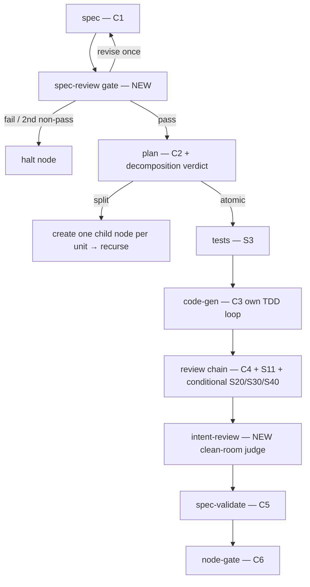

# C7 /work-orchestrator — Recursive Pipeline (canonical contract)

The authoritative description of C7's **recursive, accuracy-driven, Python-load-bearing**
workflow. C7 is **not** a fixed linear stage list any more: a run is a **tree of nodes** that the
control plane (`"${CLAUDE_PLUGIN_ROOT}/bin/forge-validate" work-orchestrator`, in `primitives/work_orchestrator/shared/`)
walks deterministically, emitting one structured prompt per round. The SKILL body drives only the
outer extract→judge→continue loop. See the design spec
[`docs/superpowers/specs/2026-06-24-work-orchestrator-recursive-redesign.md`](../../../../../docs/superpowers/specs/2026-06-24-work-orchestrator-recursive-redesign.md).

## The recursive node tree

The root node is the GitHub issue; children are work-units the planner (C2) carved out of a parent.
Node-path identity is durable (`root`, `root.0`, `root.1.0`, …). A node splits **whenever C2
reports it is more than one independent unit** — no fixed depth. A **leaf** is any node C2 calls
`atomic`. All leaves build onto one branch `foundry/<root-issue-slug>`, sequentially, so there are
no intra-run merge conflicts. Every node-state transition is persisted under
`.foundry/workflow-state/<run-id>/`, so a run is fully resumable: a resumed run reads the tree,
finds the incomplete frontier, and continues — completed nodes/stages never re-run.

Node status ∈ `pending | running | blocked | clean | not-clean | failed | skipped`. A `split`
parent is `blocked` until all children reach a terminal state, then aggregates (`clean` only when
every child is clean/skipped, else `not-clean`).

## Per-node lifecycle



The **spec-review gate** reviews the spec itself before any building: coherent? faithful to the
issue intent? not over/under-scoped? `fail` halts the node; `revise` triggers **one** bounded
re-spec retry (a second consecutive non-`pass` is treated as `fail`); `pass` proceeds to plan.

## The three execution modes

The control plane sequences three kinds of stage:

| Mode | What | Stages |
|------|------|--------|
| **1 — Pure Python** (zero model tokens) | issue parse, branch, tree-walk, split-vs-build decision, node-gate + tree-gate computation, PR prep, roll-up render | `issue`, `branch`, gate computation, `pr`, `merge` |
| **2 — Single structured judgment** (one extract/judge/continue round) | one prompt → one compact structured artifact | `spec` (C1), `spec-review`, `plan`+verdict (C2), `intent-review`, `spec-validate` (C5), `node-gate` rationale (C6) |
| **3 — Delegated sub-pipeline** (a fresh-context subagent runs a whole downstream skill and returns its structured *report*) | `code-gen` (C3 drives its own internal TDD loop), the `review` chain | `code-gen`, `review` |

### Stage → skill → mode

| Stage | Skill(s) | Mode | Notes |
|-------|----------|------|-------|
| `issue` | native `gh issue view` | 1 | SEC-8 ref validation (leading `-` rejected). |
| `branch` | native git | 1 | `foundry/<root-slug>`; **no `git push`**. Skipped on `--no-branch`. |
| `spec` | `/spec-write` (C1) | 2 | Per-node spec. |
| `spec-review` | (new judge) | 2 | `{verdict: pass\|revise\|fail, issues[]}`. Gate before building. |
| `plan` | `/planner` (C2) | 2 | Plan **+ `{decomposition: atomic\|split, children[]}`** verdict. |
| `tests` | `/test-from-spec` (S3) | 2 | Failing tests for the leaf. |
| `code-gen` | `/code-gen` (C3) | 3 | C3 drives its **own** internal TDD loop; no `git push`. |
| `review` | `/code-review` (C4) + `/security-review` (S11); conditional `/cloud-arch-review` (S20), `/frontend-design` (S30), `/api-contract-review` (S40) | 3 | Fresh-context subagents; **§3.4:** each fires its own C10/C11 internally. Returns a text report ending with a `Verdict: <pass\|review\|fail>` line the control plane folds into the node-gate (#1098). |
| `intent-review` | (new clean-room judge) | 2 | Judges the diff **against issue/spec intent** — distinct from C4's lens review. |
| `spec-validate` | `/spec-validate` (C5) | 2 | Structured criterion matrix ending with a `Verdict: <pass\|review\|fail>` line folded into the node-gate (#1098). |
| `node-gate` | `/confidence-gate` (C6) | 1 + thin 2 | Deterministic risk-scoring (Python) over the leaf's reports; only C6's short rationale is a model judgment. → `pass\|review\|fail\|incomplete`. |
| `pr` | native `gh pr create` / `gh pr comment` | 1 | Root-level, final. **Only if tree-gate `pass`.** Skipped on `--no-pr`. Pushes the feature branch first **only with `--push`** (off by default); without it, the exact push + create commands are surfaced when the branch isn't on the remote (#1107). |
| `merge` | record-only | 1 | Advisory; **never auto-merge**. |

## Two gate tiers

1. **Node-gate (per leaf):** C6 over the leaf's review chain + intent-review + spec-validate →
   `pass | review | fail | incomplete`. A non-`pass` leaf marks the node `not-clean`; siblings still
   complete so the report is exhaustive, but the tree cannot be clean.
2. **Tree-gate (root, final):** C6 over **all** node verdicts **plus** the opt-in root-level system
   reviews → the overall recommendation.

A PR is opened **only if the tree-gate is `pass`** — every leaf node-gate is `pass` *and* every
enabled root review is clean. Otherwise C7 opens **no PR** and surfaces the WorkflowReport (node
tree + every non-clean finding + resumable-state location). `--force-pr` opens a **draft** PR with
findings attached. Merge is advisory — **never auto-merge**; C7 does not push by default and
**never pushes/merges the base branch** (`--push` pushes the feature branch only, #1107).

## Root-level opt-in system reviews

`compliance-map` (S70), `data-flow-map` (S60), `threat-model` (S10), `architecture-review` (C8) are
**system-shaped, not leaf-shaped**. They do **not** run per-node. When enabled
(`--with-compliance` / `--with-threat-model` / `--with-data-flow` / `--with-arch-review`, **off by
default**), they run **once at the root** against the assembled tree and feed the **final
tree-gate**.

## §3.4 FM-audit composition

§3.4 AI-quality auditing is composed **inside** each review skill: C4/S11 (and the conditional
S20/S30/S40) fire their **own** C10 `/failure-mode-audit` + C11 `/production-failure-audit`
internally and merge the findings into their structured report. C7 does **not** invoke C10/C11
separately. The §3.4 composition is mandatory (no primitive-level opt-out); per-failure-mode
opt-outs in the consumer's `.foundry/failure-modes.yaml` are honored by the review skill itself.

## The control-plane ↔ harness seam

```mermaid
sequenceDiagram
    participant CLI as "${CLAUDE_PLUGIN_ROOT}/bin/forge-validate" work-orchestrator
    participant H as harness (SKILL.md body)
    CLI->>CLI: walk tree → next frontier node + stage
    CLI->>H: round-N-prompts.json (one structured prompt) + exit 7
    H->>H: fresh-context subagent does that one stage
    H->>CLI: round-N-judgments.json (--continue)
    CLI->>CLI: validate + apply, advance state, persist
    Note over CLI: more model work → next round (exit 7);<br/>tree complete → render report (exit 0/4/5)
```

## Resume semantics

State is persisted under `.foundry/workflow-state/<run-id>/` after every node-state transition
(`tree.json` + `nodes/<path>/node.json`, see `shared/state_store.py`). On resume, the control plane
loads the tree, walks to the incomplete **frontier** node, and continues; completed nodes/stages
never re-run. Pass `--run-id` to resume a specific run and `--start-from NODE` to override the
resume cursor.

## Exit codes

| Code | Meaning |
|------|---------|
| 0 | Tree complete, tree-gate `pass` (PR opened, or prepared if `--no-pr`) |
| 2 | Issue ref not found / unresolvable; `--start-from` names a node not in the tree or has no run to resume; or the branch stage failed (halts before any prompt) |
| 3 | `--workflow-yaml` or judgments envelope malformed (or `--workflow-yaml` over the 256 KiB cap) |
| 4 | Tree-gate not clean (`review`/`fail`) — **no PR opened**, report surfaced |
| 5 | A hard stage failure halted a node (build / spec-review failure) |
| 7 | Awaiting judgments (a `round-N-prompts.json` was written) |

> **`--workflow-yaml` is accepted-but-inert** — validated (exists, ≤256 KiB, YAML mapping; else exit
> 3) but its contents are not yet consumed. Reserved for future use; it changes no behavior today.
